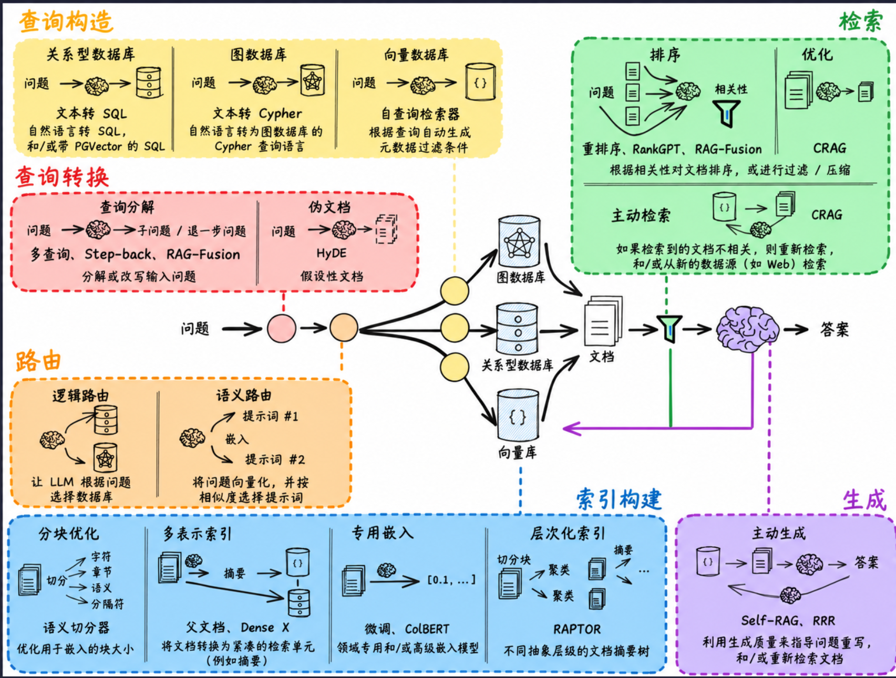

# RAG From Scratch

## 并行科技 API 配置（Qwen）

本项目的 5 个 notebook 通过 `rag_config.py` 统一读取项目目录下的 `.env`。

| 用途 | 平台模型 ID |
| --- | --- |
| 聊天、查询改写、回答生成 | `Qwen3.8-Flash` |
| 文档和问题向量化 | `GLM-Embedding-3` |

这两个 ID 已从当前账号的 `/v1/models` 列表中确认。该列表没有 Qwen 向量模型，
因此向量化使用同平台的 GLM 模型。两者使用同一个并行科技密钥，不需要下载本地模型。

1. 在 VS Code notebook 右上角选择 `D:\conda_envs\rag_langchain_312\python.exe`。
2. 执行 notebook 首个安装单元格 `%pip install -r requirements.txt`，安装后重启内核。
3. 在 `.env` 填写以下配置（可以参考 `.env.example`）：

   ```dotenv
   PARATERA_API_KEY=你的并行科技密钥
   PARATERA_BASE_URL=https://llmapi.paratera.com/v1
   PARATERA_CHAT_MODEL=Qwen3.8-Flash
   PARATERA_EMBEDDING_MODEL=GLM-Embedding-3
   ```

4. 从配置单元格开始，按顺序运行 `rag_from_scratch_1_to_4.ipynb`。

旧的 `OPENAI_API_KEY` 不参与这些模型调用；客户端显式使用 `PARATERA_API_KEY`。
修改 `.env` 后，重新运行配置及创建模型的单元格即可。模型 ID 大小写必须与平台一致。
更换向量模型后应重建向量库，不能混用不同模型产生的向量。

`make_embeddings()` 发送原始文本、请求浮点向量，每批最多 16 条，避免把 OpenAI
token ID 发送给其他厂商；GLM-Embedding-3 的单条文本上限需遵循平台文档。
教程中的 `tiktoken` 单元格仅用于演示 token 计数，不代表 Qwen 或 GLM 的实际计费 token 数。

教程使用的 RAG prompt 已放到本地 `rag_prompt()`，无需联网访问 LangChain Hub。
LangSmith 是可选的：需要追踪时保留自己的配置，否则设置 `LANGCHAIN_TRACING_V2=false`。
原始 notebook 已备份到被 Git 忽略的 `output/original_notebooks/`；迁移时清除了原始运行输出，
避免把旧模型的结果误认为本次 API 的结果。

### 后续章节的额外依赖

- `10_and_11` 的 YouTube 示例另需 `youtube-transcript-api`、`pytube`，还受视频字幕可用性影响。
- `12_to_14` 的 ColBERT 示例使用 `ragatouille` 并下载本地模型，这是原教程的独立实验。
- `15_to_18` 的最后一个 Cohere rerank 示例另需 `langchain-cohere` 和 `COHERE_API_KEY`；
  并行科技密钥不能直接用于 Cohere。该可选示例不属于 Qwen 聊天和 GLM 向量调用。

平台文档：[API 入门](https://ai.paratera.com/document/llm/quickStart/useApi)、
[向量化模型](https://ai.paratera.com/document/llm/modalAbility/embedding)。

---

LLMs are trained on a large but fixed corpus of data, limiting their ability to reason about private or recent information. Fine-tuning is one way to mitigate this, but is often [not well-suited for factual recall](https://www.anyscale.com/blog/fine-tuning-is-for-form-not-facts) and [can be costly](https://www.glean.com/blog/how-to-build-an-ai-assistant-for-the-enterprise).
Retrieval augmented generation (RAG) has emerged as a popular and powerful mechanism to expand an LLM's knowledge base, using documents retrieved from an external data source to ground the LLM generation via in-context learning. 
These notebooks accompany a [video playlist](https://youtube.com/playlist?list=PLfaIDFEXuae2LXbO1_PKyVJiQ23ZztA0x&feature=shared) that builds up an understanding of RAG from scratch, starting with the basics of indexing, retrieval, and generation. 

 
 
[Video playlist](https://www.youtube.com/playlist?list=PLfaIDFEXuae2LXbO1_PKyVJiQ23ZztA0x)
